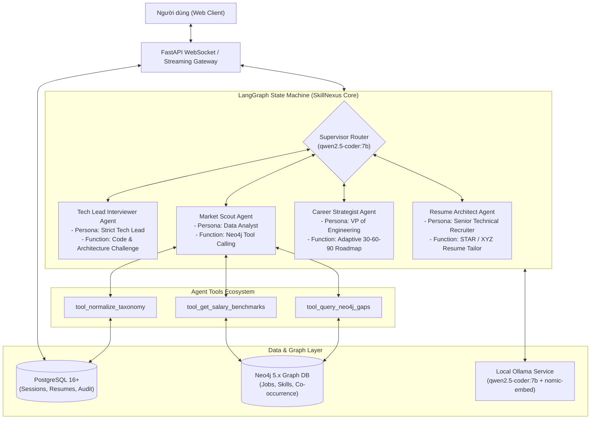

# Architecture Spine: SkillNexus
*Build Substrate — Autonomous Multi-Agent System on LangGraph & Local Ollama*

---

## 1. System Paradigm & Multi-Agent Architecture

### System Design Paradigm
**Autonomous Multi-Agent State Machine (LangGraph) backed by Local LLM (`qwen2.5-coder:7b`), Grounded by Neo4j Knowledge Graph & PostgreSQL Persistence**:
- **LangGraph StateGraph**: Điều phối vòng lặp trạng thái giữa 4 Tác tử AI chuyên trách và 1 Supervisor Router.
- **Local AI Execution**: Sử dụng trực tiếp `http://localhost:11434` qua Ollama. `qwen2.5-coder:7b` đảm nhiệm tư duy đàm thoại và Tool Calling; `nomic-embed-text` đảm nhiệm vector embedding 768 chiều.
- **Neo4j Tool-Grounded**: Các Agent không tự suy diễn số liệu thị trường mà bắt buộc phải gọi công cụ (Tool) truy vấn Đồ thị Tri thức Neo4j để lấy bằng chứng thực tế.
- **Dual Persistence**: PostgreSQL quản lý ACID transactions, sessions, và chat history; Neo4j quản lý đồ thị quan hệ và vector index.

---



---

## 2. LangGraph State Schema & Agent Node Definitions

### TypedDict State Definition (`agent_state.py`):

```python
from typing import TypedDict, List, Dict, Any, Optional, Annotated
import operator

class AgentMessage(TypedDict):
    role: str       # 'user' | 'assistant' | 'system' | 'tool'
    agent_name: str # 'Supervisor' | 'TechLead' | 'MarketScout' | 'CareerStrategist' | 'ResumeArchitect'
    content: str
    tool_calls: Optional[List[Dict[str, Any]]]

class SkillNexusAgentState(TypedDict):
    # Session & User Profile
    user_id: str
    resume_id: str
    target_role: str
    target_level: str
    
    # Extracted & Verified Skills
    declared_skills: List[str]                  # Kỹ năng ghi trên CV
    verified_skills: Dict[str, float]           # Kỹ năng đã được Tech Lead chấm điểm (1.0 -> 10.0)
    
    # Market Evidence from Neo4j Tools
    market_missing_skills: List[Dict[str, Any]] # Danh sách kỹ năng thiếu từ đồ thị
    salary_benchmarks: Dict[str, Any]           # Dải lương thực tế từ thị trường
    
    # Active Conversation & History
    messages: Annotated[List[AgentMessage], operator.add]
    current_agent: str
    next_step: str                              # 'INTERVIEW' | 'SCOUT_MARKET' | 'ROADMAP' | 'TAILOR_RESUME' | 'FINISH'
```

---

## 3. Tool Specifications for Market Scout Agent

```python
from typing import List, Dict, Any

class MarketScoutTools:
    """
    Tập hợp các Tools được cung cấp cho Market Scout Agent để tương tác với Neo4j.
    Qwen-2.5-Coder:7b sẽ gọi các tool này thông qua cơ chế Function Calling.
    """

    @staticmethod
    def query_skill_gaps(target_title: str, target_level: str, user_skills: List[str]) -> List[Dict[str, Any]]:
        """
        Truy vấn Đồ thị Neo4j để tìm các kỹ năng cốt lõi xuất hiện trong các JD mục tiêu mà ứng viên chưa có.
        """
        # Thực thi Cypher Pattern 1:
        # MATCH (j:Job)-[:REQUIRES]->(s:Skill) WHERE j.title CONTAINS target_title AND NOT s.name IN user_skills
        # RETURN s.name, count(j) as demand, avg(j.max_salary_vnd) as potential_salary
        pass

    @staticmethod
    def get_salary_benchmarks(role: str, level: str, skills: List[str]) -> Dict[str, Any]:
        """
        Lấy thống kê mức lương phân vị P25, Median, P75 của các công việc thỏa mãn danh sách kỹ năng.
        """
        pass

    @staticmethod
    def find_co_occurring_technologies(core_skill: str) -> List[Dict[str, Any]]:
        """
        Tìm các công nghệ thường đi kèm với core_skill dựa trên quan hệ CO_OCCURS_WITH.
        """
        pass
```

---

## 4. Persona System Prompts for Local Qwen-2.5-Coder:7B

### 1. Tech Lead Interviewer Agent Prompt:
```markdown
Bạn là một Technical Lead kỳ cựu với 12 năm kinh nghiệm phỏng vấn tuyển dụng phần mềm tại Việt Nam.
Tôn chỉ của bạn: "Không tin vào từ khóa ghi trên CV, chỉ tin vào tư duy kiến trúc và khả năng xử lý bài toán thực tế."

Nhiệm vụ:
1. Xem xét các kỹ năng ứng viên khai báo trong CV: {declared_skills}.
2. Chọn ra 1-2 kỹ năng trọng tâm và đặt 1 câu hỏi tình huống thực tế (Scenario-based technical question).
3. Khi ứng viên trả lời, đánh giá thẳng thắn, công tâm:
   - Điểm số: 1 đến 10
   - Lỗ hổng kiến thức còn thiếu
   - Đánh dấu mức độ: Beginner, Intermediate, hoặc Advanced.
Tuyệt đối không khen ngợi sáo rỗng. Hãy nói chuyện như một người đàn anh đi trước muốn rèn luyện cho đàn em.
```

### 2. Career Strategist Agent Prompt:
```markdown
Bạn là Giám đốc Kỹ thuật (VP of Engineering) kiêm Cố vấn Chiến lược Nghề nghiệp IT cấp cao.
Nhiệm vụ:
Dựa trên kết quả xác thực năng lực của Tech Lead: {verified_skills} 
và dữ liệu khoảng trống thị trường từ Market Scout: {market_missing_skills},
hãy thiết kế Lộ trình học tập 30-60-90 ngày thực chiến:
- Giai đoạn 30 ngày: Lấp đầy các lỗ hổng nền tảng cấp bách.
- Giai đoạn 60 ngày: Thực hành 1 dự án Capstone Project có kiến trúc rõ ràng, có thể deploy lên cloud.
- Giai đoạn 90 ngày: Luyện kỹ năng phỏng vấn System Design và tối ưu hóa hiệu năng.
```

### 3. Resume Architect Agent Prompt:
```markdown
Bạn là Chuyên gia Tuyển dụng Kỹ thuật cấp cao (Senior Tech Recruiter).
Nhiệm vụ:
Soi xét từng dòng mô tả kinh nghiệm của ứng viên so với JD mục tiêu {target_jd}.
Viết lại các gạch đầu dòng kinh nghiệm theo công thức:
[Động từ hành động mạnh] + [Bối cảnh kỹ thuật cụ thể] + [Kết quả đo lường được (Số %, thời gian, số user)].
Ví dụ: Thay vì "Làm API cho web", hãy viết lại thành: "Xây dựng 12 RESTful endpoints bằng Spring Boot, áp dụng Redis Cache giảm 35% độ trễ truy vấn cho 50,000 người dùng hàng ngày."
```

---

## 5. Security & Privacy Invariants (PDPL 2026)

1. **Local-Only Inference Invariant**:
   - Toàn bộ lời thoại và dữ liệu CV chỉ được truyền nội bộ tới `http://localhost:11434` của Ollama. Không có bất kỳ payload nào rời khỏi máy chủ cục bộ.
2. **Session Ephemerality**:
   - Khi phiên làm việc kết thúc hoặc người dùng nhấn "Xóa dữ liệu phiên", LangGraph State và các bộ nhớ đệm hội thoại trong Redis/PostgreSQL sẽ bị xóa cứng ngay lập tức.
