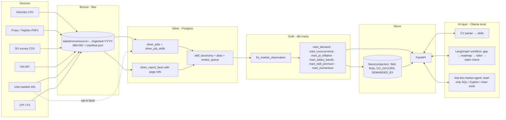

# SkillNexus — Coach's Feature Pick & Feasibility Analysis

> **Update 2026-10-22:** the pick was adopted. Research results (VietJobs IT subset size, robots.txt, sitemaps, ToS) are folded into §3.1 and §6 (O2, O4, O25). The design continues in [`../../proposal-skillnexus/architecture-overview.md`](../../proposal-skillnexus/architecture-overview.md) and the proposal in [`../../proposal-skillnexus/proposal-skillnexus.html`](../../proposal-skillnexus/proposal-skillnexus.html).

This is **one opinionated pick**, made so you have something to compare your own pick and research against. Feature IDs (A2, B5, …) refer to [feature-catalog.md](feature-catalog.md).

**Constraints this analysis assumes**
- **6–8 weeks** to demo. **No live crawling at first**: backfill and annual reports come first, crawling comes later.
- The project must include a **real data workflow** (DE/DS) **and AI augmentation** (LLM / RAG / agent), be learning-heavy, solve a real pain point, and be somewhat business-viable.
- Team size: the spec plans for **3 engineers** (DE, AI-DE, AI-APP). If you have fewer people, use the *minimum cut* in §2.3.

---

## 1. How every feature was triaged

**Criteria** (1–5 unless noted):
- **P**ain: strength of the evidence that the pain is real
- **G**ap: how poorly existing products cover it
- **L**earning: which of DE / DS / AI it exercises
- **F**easibility: can it be done in 6–8 weeks **without live crawl data**? (H / M / L)

**Verdicts**
- **CORE**: in the MVP
- **CORE·bp**: a free byproduct of another core feature
- **STRETCH**: only if time remains
- **LATER**: phase 2, after crawling starts or outcome data exists
- **DROP**: not worth it, or blocked

| ID | Feature | P | G | L | F | Verdict | Why |
|---|---|---|---|---|---|---|---|
| A1 | Market statistics (umbrella) | 4 | 4 | DE DS | H | CORE | Delivered by A2 + A3 + A4 |
| A2 | Skill demand by role × level × city | 4 | 4 | DE DS | H | **CORE** | Base table for every other feature |
| A3 | Skill bundle explorer | 3 | 4 | DS graph | H | **CORE** | Justifies Neo4j; strong visual |
| A4 | JD inflation index | 5 | 5 | DS | M | **CORE** | Signature insight; directly measures a top pain |
| A5 | Salary transparency index | 4 | 4 | DS | H | CORE·bp | One extra aggregate on the same table |
| A6 | Outsource vs product stacks | 3 | 3 | DS | L | LATER | VietJobs has **no company field** |
| A7 | JD language share | 2 | 3 | DS | M | STRETCH | Language detection on description text |
| A8 | Ask-the-market agent | 3 | 3 | AI | M | **CORE** | AI showcase. An academic prototype exists, so we differentiate with citations and time-awareness |
| B1 | Old data + future trend (umbrella) | 4 | 4 | DS | M | CORE (reduced) | Delivered as B5 → B2 momentum, **not** forecasts |
| B2 | Skill momentum score | 4 | 4 | DS | M | **CORE** | Yearly granularity only, labelled honestly |
| B3 | Emerging skill detector | 3 | 5 | AI DS | M | STRETCH | Needs dated new text (report-year diff, or user-pasted JDs) |
| B4 | Hype vs hiring gap | 3 | 4 | DS | L | LATER | Google Trends has no official API; scrapers break often |
| B5 | Digitize annual reports | 3 | 4 | DE AI | H | **CORE** | The only VN time axis we can get now |
| B6 | HN "Who is Hiring" global indicator | 2 | 3 | DE DS | M | STRETCH | The only dense *monthly* series pre-crawl, but global |
| B7 | Forecast with uncertainty bands | 4 | 3 | DS | L | LATER | 4–5 yearly points can't support a forecast |
| B8 | Job-ready-date scenario | 3 | 4 | DS | L | LATER | Depends on B7 |
| C1 | "What am I worth" range | 5 | 4 | DS | M | **CORE** | Same regression as C2 |
| C2 | Skill salary premium | 5 | 5 | DS | M | **CORE** | Strongest DS learning; strongest pain |
| C3 | Hidden-salary imputation | 4 | 4 | DS ML | M | STRETCH | VietJobs paper gives a baseline to beat |
| C4 | Salary ladder by company type | 3 | 3 | DS | L | LATER | Needs a company type field |
| C5 | Negotiation brief | 4 | 3 | AI | H | STRETCH | Thin LLM layer over C1/C2 |
| C6 | Gross ↔ Net calculator | 3 | 2 | — | H | LATER | Pure software; zero data/AI learning |
| C7 | Real vs nominal wage trend | 3 | 4 | DS | H | **CORE** | Small, and examiners like it |
| D1 | "Chance on the market" (umbrella) | 5 | 4 | DS AI | M | CORE (reframed) | Becomes D4. No hiring-outcome data exists, so we can't claim a probability |
| D2 | Tailor CV to a JD / mass-send | 5 | 2 | AI | H | **CORE** (merged D2+D3) | Crowded, so it must be *market-grounded* to stand out |
| D3 | Create CV for a JD | 5 | 2 | AI | H | **CORE** (merged) | Generated only from CV facts, never invented |
| D4 | Market-readiness / coverage score | 5 | 4 | DS AI | H | **CORE** | The honest version of "chance" |
| D5 | Batch tailoring for N JDs | 4 | 3 | AI | H | STRETCH | A loop over D2 |
| D6 | CV red-flag linter | 4 | 3 | AI | H | STRETCH | Mostly prompt + rules |
| D7 | Bullet strength scorer | 3 | 2 | AI | H | STRETCH | Folded into the D2 prompt |
| D8 | Claim-vs-evidence check | 4 | 4 | AI | H | **CORE** | Guardrail that makes D2/D3 trustworthy |
| D9 | VN ↔ EN translation | 3 | 2 | AI | H | LATER | Generic LLM capability, no data value |
| D10 | ATS parse simulator | 2 | 2 | AI | M | DROP | There's no single ATS to simulate; low data value |
| D11 | GitHub analyzer | 3 | 3 | DE AI | M | LATER | Nice, but off the market-data spine |
| D12 | CV versions vs callbacks | 4 | 4 | DS | L | LATER | Needs outcome tracking over weeks |
| E1 | Chance map (probability) | 5 | 4 | DS | L | DROP → D4 | No outcome labels to learn a probability from |
| E2 | Reach / match / safety lists | 4 | 4 | DS | M | LATER | Can be approximated from D4 thresholds later |
| E3 | Ghost-job detector | 4 | 5 | DE DS | L | LATER | Needs repeated crawls over time; **best phase-2 feature** |
| E4 | Application tracker | 4 | 3 | DE DS | M | LATER | Generic CRUD until enough users exist |
| E5 | Cover letter generator | 3 | 1 | AI | H | LATER | Crowded and generic |
| F1 | Roadmap to desired job | 4 | 4 | AI | H | **CORE** (merged F1+F3+F4+F5+F6) | "Gap roadmap" |
| F2 | Best-ROI roadmap | 4 | 5 | DS AI | M | STRETCH | Optimization over C2 × A2 × distance |
| F3 | Shortest path on skill graph | 3 | 4 | DS graph | M | **CORE** (merged) | Orders the roadmap |
| F4 | Time-budget-aware plan | 4 | 4 | AI | H | **CORE** (merged) | Already in PRD FR-403 |
| F5 | Capstone generator | 4 | 3 | AI | H | **CORE** (merged) | Already in PRD FR-402 |
| F6 | Resource curator (RAG) | 3 | 3 | AI | H | **CORE-lite** (merged) | A small curated list is enough |
| F7 | Adaptive re-plan | 3 | 4 | AI | M | LATER | Needs returning users |
| F8 | Career pivot paths | 4 | 4 | DS graph | M | STRETCH | Role-to-role path on the same graph |
| F9 | Level-up diff | 4 | 4 | DS | H | CORE·bp | A2 segment comparison |
| G1 | Tech-lead mock interview | 3 | 2 | AI | M | LATER | Fragile on a 7B model; low data-field learning; crowded |
| G2 | Adaptive quiz | 3 | 3 | DS AI | L | LATER | Needs a question bank and calibration |
| G3 | Interview prep by company type | 3 | 3 | AI | M | LATER | No grounding data |
| H1 | Company tech-stack profile | 4 | 3 | DS | L | LATER | Needs company field; jobspipe.dev already does this |
| H2 | JD decoder | 4 | 4 | AI | H | STRETCH | Reuses the JD extractor almost free |
| H3 | JD quality score | 3 | 4 | AI DS | M | LATER | |
| I1 | Curriculum-vs-market report | 3 | 5 | DS | M | STRETCH (business) | Same marts, different audience: the B2B story |
| I2 | Next-course recommender | 3 | 4 | DS | L | LATER | |
| I3 | Recruiter JD inflation checker | 3 | 4 | AI | M | LATER | |
| I4 | Weekly market newsletter | 3 | 3 | DE AI | H | STRETCH | Shows the pipeline + LLM summarization end to end |

---

## 2. The pick

### 2.1 Product story: one chain, one source of truth

> **Market truth → My gap → My plan → My CV**
> Every screen is computed from the **same gold tables**. Every number shows **its source, period and sample size**.

```
 ┌──────────────────┐   ┌──────────────────┐   ┌──────────────────┐   ┌──────────────────┐
 │ M1 MARKET PULSE  │──▶│ M2 TREND & SALARY│──▶│ M3 MY GAP & PLAN │──▶│ M4 MY CV         │
 │ A2 demand        │   │ B5→B2 momentum   │   │ D4 coverage score│   │ D2+D3 JD-tailored│
 │ A3 skill bundles │   │ C1 worth range   │   │ F1 gap roadmap   │   │ D8 claim check   │
 │ A4 JD inflation  │   │ C2 skill premium │   │  (F3 order, F4   │   │ (D5 batch)       │
 │ A8 ask-the-market│   │ C7 real wages    │   │   time, F5, F6)  │   │                  │
 │ +A5, F9 bypr.    │   │                  │   │                  │   │                  │
 └──────────────────┘   └──────────────────┘   └──────────────────┘   └──────────────────┘
        DE + DS                DS                  DS + AI                  AI
```

**Why this set.**
- **Pain:** it covers the three strongest pain points: salary opacity (C), skill gap/roadmap (F), and ghosting/CV (D).
- **Learning:** it exercises all three skill areas in proportion: a real DE pipeline (M1, B5), real DS modelling (A4, B2, C2, C7), and real AI (A8, F1, D2/D8).
- **Feasibility:** none of it needs live crawl data.
- **Differentiation** from the closest existing work, the academic *AI Job Market Consultant* (arXiv 2511.14767: a ReAct agent over 3,745 crawled posts):
  1. **Time-aware and honest.** It combines several backfill sources, each with a confidence label.
  2. **The CV → gap → plan → CV chain** runs on the same evidence.
  3. **Salary-premium modelling** per skill.
  4. **Local-first CV privacy.**
- **Business:** M1 can be a free acquisition tool, with M3/M4 as the paid tier. I1 turns the same marts into a B2B report for universities and training centers. I4 is a growth channel.

### 2.2 Stretch, in recommended order

1. **H2 JD decoder**: almost free once the JD extractor exists.
2. **B3 Emerging skill detector**: diff skill vocabularies between report years and user-pasted JDs.
3. **C3 Hidden-salary imputation**: benchmark against the VietJobs paper's LLM baselines.
4. **I4 Weekly newsletter**, then **I1 curriculum report** for the business story.
5. **B6 HN monthly indicator**, then **F2 best-ROI roadmap**, then **F8 pivot paths**.

### 2.3 Minimum cut (if the team is smaller or time slips)

`A2 · A4 · B5→B2 · C2 · D4 · F1 · D2+D8 · A8`. That's eight features and still a complete chain.

---

## 3. Inputs

### 3.1 External data. What exists, and what each source gives

| # | Source | What it gives | Time axis | Access & cost | Legal / license | Verdict |
|---|---|---|---|---|---|---|
| S1 | **VietJobs** — HF `dinhieufam/VietJobs`, code `VinNLP/VietJobs`, LREC 2026 (arXiv 2603.05262) | 48,092 postings, **16 sectors (not IT-only)**. Columns: `job_title`, `category`, `location`, `technical_skills`, `soft_skills`, `experience_required`, `salary_min/max`, `salary`, `description`, `requirements_text`, … **No company column** | **No posting-date column** in the viewer; collection period not stated on the card → check the paper | Free download | Paper is CC BY 4.0; **dataset license not confirmed**, check the card/repo | **CORE (seed)**: one-week TopCV crawl, July 2025. **Measured 2026-10-22:** 1,906 IT-category rows; ≈794 real software/data postings across all categories; 342 with salary |
| S2 | **ITviec IT Salary Reports** | Survey salaries by position / years of experience / language | **4 editions**: 2022-23 (n=1,257), 2023-24 (n=2,207, 25 positions), 2024-25 (n=2,324), 2025-26 (n=1,839) | Free PDFs / web pages | Facts with citation | **CORE**: 4 yearly salary points |
| S3 | **TopDev reports** | Market size, developer demographics, popular tech, hiring demand | Editions found: 2021, 2022, 2023, 2024-25 (some behind sign-up) | Free (form) | **Must cite report + publisher** | **CORE**: yearly demand points |
| S4 | **Stack Overflow Developer Survey** | Tech used, salary, experience (global; VN subset) | Yearly CSV since 2011 | Free | **ODbL 1.0** (share-alike if you redistribute a derived DB) | **CORE**: global baseline; VN subset has small n |
| S5 | **HN "Who is Hiring"** (Algolia HN API) | Global (mostly US/remote) postings: stack, remote, sometimes salary | **Monthly since 2011** | Free public API | Public user content; extract facts only | **STRETCH**: only dense monthly series |
| S6 | **jobspipe.dev** | Daily VN postings → company ↔ technology, confidence-graded | Daily, "live" | Free key (1,000 jobs), sandbox without key | **ToS not checked** | **VERIFY**: possible live VN feed without scraping |
| S7 | **User-pasted JDs** (from D2/D4) | Real, dated VN JDs the users care about | Live, from day 1 of usage | Free | Opt-in consent; store extracted facts + date only | **CORE**: the data flywheel |
| S8 | **CPI + FX** (World Bank / GSO) | Inflation index, USD↔VND | Yearly / monthly | Free | Open | **CORE** (tiny) |
| S9 | **Curated learning resources** | ~3–5 free resources per top-50 skill | — | Manual curation (~1 day) | Links only, no copied content | **CORE** (tiny) |
| S10 | Paid scrapers (Apify actors for ITviec / TopCV / VietnamWorks) | Full postings with salary, level, skills | On demand | ~$3 / 1,000 jobs (20k jobs ≈ $60) | **Still breaches the target sites' ToS**; you carry the risk | **LATER**: phase 2, only after legal review |
| S11 | Own crawler | Dated snapshots | Daily / weekly | Dev time | Major VN boards prohibit automated harvesting in ToS; facts-only + robots.txt + low rate | **LATER**: phase 2 |
| S12 | Common Crawl / Wayback snapshots of job pages | Historical dated VN postings | Years | Free, high effort | Grey zone (copyright / ToS) | **EXPERIMENTAL**: research note only |
| S13 | Kaggle VN job datasets | Unknown; one cited "Vietnam Jobs Dataset" (Nguyen, 2025) has mostly titles only | Unknown | Free | Varies | **RESEARCH**: look for ones with posting dates |
| — | Commercial feeds (Techmap, Techsalerator) | ~39k VN postings / month | Live | Paid | Licensed | DROP for MVP (cost) |

### 3.2 Inputs from the user

| Input | Used by | Sensitivity | Handling |
|---|---|---|---|
| CV file (PDF / DOCX) | D4, F1, D2, D8, C1 | **PII** (PDPL) | Explicit consent (already enforced in [main.py](../../../backend/app/main.py)); parsed **locally only**; raw file auto-deleted (e.g. 24h); parsed skills kept until the user deletes |
| Target role, level, city | All personal features | Low | Form |
| Weekly time budget | F4 | Low | Form ("hours per week") |
| Salary expectation | C1, C5 | Medium | Optional |
| Target JD text(s) | D2, D3, D5, D4 | Public content | Extract → **opt-in** contribution to market data (facts + date, unlinked from the user) |
| GitHub username | D11 (later) | Low | Optional, later |

### 3.3 Which feature needs which input

| Feature | S1 VietJobs | S2 ITviec | S3 TopDev | S4 SO | S7 user JDs | S8 CPI | S9 resources | User CV |
|---|---|---|---|---|---|---|---|---|
| A2 demand · A5 · F9 | ● | ◐ | | | ◐ | | | |
| A3 bundles | ● | | | ◐ | ◐ | | | |
| A4 JD inflation | ● | | ◐ | | ◐ | | | |
| A8 ask-the-market | ● | ● | ● | ● | ● | ● | | |
| B5 → B2 momentum | | ● | ● | ● | | | | |
| C1 · C2 salary | ● | ● | | ◐ | | | | ● (C1) |
| C7 real wages | | ● | | | | ● | | |
| D4 coverage | ● | | | | ◐ | | | ● |
| F1 gap roadmap | ● | ◐ | | | | | ● | ● |
| D2/D3 + D8 tailoring | ◐ | | | | ● | | | ● |

● = primary input · ◐ = secondary / enrichment

---

## 4. Process: from input to output

### 4.1 Principles

1. **Math computes, the LLM narrates.** Every number comes from SQL, Cypher or a model. The LLM only explains it, writes text and picks tools. A 7B model fed raw rows will invent numbers.
2. **Every number carries provenance:** `source · period · sample size · confidence`. If n < 30, the cell is hidden or flagged. Stale data never poses as current.
3. **Postgres is the source of truth.** Neo4j is a derived read model, rebuilt by a batch task. No CDC.
4. **Bronze is immutable.** Raw files are kept as downloaded, with a manifest (url, hash, license, retrieved_at). Everything downstream is re-runnable.
5. **Facts, not text.** For scraped or third-party content, store extracted entities and dates, never verbatim JD text. VietJobs is an open dataset, so it's exempt *if* its license allows.
6. **User data never enters the shared market graph.** User skills live in Postgres and are overlaid on market data at query time. That makes one-click deletion trivial (PDPL).

### 4.2 Pipeline



### 4.3 Stages

| Stage | What happens | Tools | Learning |
|---|---|---|---|
| **0 · Ingest** | Download / pull each source into Bronze as-is, with a manifest | Python + Airflow tasks | `DE`: idempotent ingestion, partitioning, lineage |
| **1 · Extract** | **VietJobs:** filter IT categories; split `technical_skills`; parse `salary_min/max` (million VND); map `experience_required` → level. **Reports:** PDF → tables (Docling / pdfplumber) → LLM structures each table to JSON with page ref → **human verifies** (only ~4–8 PDFs). **HN:** dictionary skill tagging (fast, deterministic); LLM only for salary/location on a sample. **User JDs:** LLM JSON extraction (existing `extract_jd_entities`) | pandas/polars, Docling, Ollama JSON mode | `DE` `AI`: LLM-in-ETL, human-in-the-loop |
| **2 · Normalize** | Canonical skills: alias dict → RapidFuzz ≥ 92 → embedding cosine ≥ 0.86 → **review queue** (spec §5.1). Map report positions ↔ our role taxonomy. Map levels. Convert currency; CPI-deflate | RapidFuzz, bge-m3 | `DS`: entity resolution |
| **3 · Model (gold)** | dbt builds `fct_market_observation` + marts; **dbt tests** (not null, accepted values, n ≥ threshold, freshness) | dbt-core + dbt-postgres | `DE`: dimensional modelling, data quality |
| **4 · Analyze** | Co-occurrence lift/PMI · JD-inflation definition · salary regression · momentum slopes · (stretch) imputation model. EDA notebooks are deliverables | statsmodels, scikit-learn, Jupyter | `DS`: the heart of the "data insight" requirement |
| **5 · Project** | Rebuild Neo4j from marts (skills, roles, weighted edges); embeddings for JDs and resources | Neo4j, Python driver | `DE`: polyglot persistence |
| **6 · Serve + AI** | FastAPI endpoints; LangGraph workflow; ask-the-market agent with read-only, whitelisted views, LIMIT + timeout, mandatory citations | FastAPI, LangGraph, Ollama | `AI`: tool-use, guardrails |
| **7 · Evaluate** | Gold sets: **50 hand-labelled JDs** (extraction precision/recall), **10 CVs** (skill parsing), **30 market questions** (agent answer accuracy), normalizer coverage %. Re-run on every model or prompt change | pytest, small scripts (Ragas optional) | `DS` `AI`: you can *prove* quality at the defense |

### 4.4 The key design: one table for every time granularity

Our backfill sources disagree on **granularity**: VietJobs is a snapshot, the reports are yearly surveys, HN is monthly postings. Mixing them naively produces fake trends. To prevent that, every metric lands in one long fact table that records what kind of observation it is:

```sql
fct_market_observation (
  source          -- 'vietjobs' | 'itviec_2024_25' | 'topdev_2023' | 'so_2025' | 'hn' | 'user_jd'
  source_kind     -- 'job_posting' | 'salary_survey' | 'dev_survey'
  period_start, period_end, granularity   -- 'snapshot' | 'year' | 'month'
  geo             -- 'VN' | 'VN-HN' | 'VN-HCM' | 'GLOBAL'
  role, level, skill                      -- canonical; NULL = all
  metric          -- 'demand_share' | 'salary_p25' | 'salary_median' | 'salary_p75' | 'usage_share' …
  value, unit     -- e.g. 0.42 'share' / 31000000 'VND_month' / 'USD_month'
  n               -- sample size behind the value
  confidence      -- derived from n and number of periods
)
```

Momentum (B2) is only computed **within one source series** (e.g. ITviec 2022 → 2025). Cross-source comparisons are shown side by side and labelled, never joined into one line.

### 4.5 How each core feature is computed

| Feature | Recipe |
|---|---|
| **A2** demand | `count(distinct job with skill) / count(jobs in segment)` per role × level × city. Hide n < 30 |
| **A3** bundles | Pair counts over `silver_job_skills` → lift / PMI; keep edges with lift > 1.2 and count ≥ 20 → Neo4j `CO_OCCURS_WITH {lift, n}` → graph view |
| **A4** JD inflation | **Data-driven "senior stack"**: the skills with the highest lift in Senior posts vs Fresher posts. Index = share of Fresher/Junior posts that require ≥ 2 yrs **or** ≥ 2 senior-stack skills. Snapshot now; becomes a trend once S7/S11 dated data accumulates |
| **A8** agent | LangGraph ReAct loop with tools `sql(view, filters)`, `cypher(template)`, `chart(spec)` over **whitelisted gold views only**. Every answer cites view + period + n. Scored on the 30-question gold set |
| **B5 → B2** momentum | Extract report tables → `fct_market_observation (granularity='year')` → per skill/role/position within each source: log-linear slope over ≥ 3 points → **Rising / Flat / Falling** + confidence. No numeric next-year prediction |
| **C1 / C2** salary | VietJobs IT postings: `log(mid_salary) ~ skills (top-50 dummies) + level + city + role` (OLS / quantile regression). Premium = `exp(β) − 1` with 95% CI; show only when significant and n ≥ 30. Cross-check against ITviec medians (survey ≠ advertised salary, so label both). C1 = prediction interval for the user's skill vector |
| **C7** real wages | ITviec yearly medians ÷ CPI index (base year) → nominal vs real line |
| **D4** coverage | Normalized CV skills vs target segment: `Σ demand_share(matched) / Σ demand_share(top-N skills)`, plus top missing skills with demand %. Shown as *"covers 62% of skill demand across 412 Junior Backend posts"*, **never as a hiring probability** |
| **F1** gap roadmap | Rank missing skills with the spec's priority formula (§5.2: 0.45 demand + 0.35 co-occurrence synergy + 0.20 salary). **Order** with a small hand-curated prerequisite graph (top-50 skills) + co-occurrence (F3). **Size** with curated effort hours per skill ÷ weekly budget (F4). LLM writes the narrative + one capstone (F5) and attaches curated resources (F6) |
| **D2 / D3 + D8** tailoring | JD → extraction → present/missing keywords vs CV → LLM rewrites bullets **using only CV facts** (XYZ form) → **claim check**: every skill or metric in the output must trace to the CV, otherwise it's moved to "to learn" → diff view. Batch over saved JDs = D5 |

---

## 5. Tech stack

| Layer | Choice | vs current repo | Why | Fallback |
|---|---|---|---|---|
| Orchestration | **Apache Airflow** (LocalExecutor / standalone) | Spec had it; **missing from docker-compose** | Most-requested DE orchestrator in VN DE JDs; high learning value | Dagster, or Makefile + cron if RAM is tight |
| Bronze storage | **Local partitioned folders** + manifest | **Replaces MinIO** | MinIO community edition stopped shipping images/binaries (Oct 2025) and was archived in 2026 | SeaweedFS / Garage if an S3 API is needed |
| Warehouse | **PostgreSQL 16** | Keep | SQL time-window analytics; also serves the app | DuckDB for heavy local EDA |
| Transform + DQ | **dbt-core** (+ dbt tests) | Add (spec had it) | Lineage, tests, docs: standard DE practice | Plain SQL scripts |
| Graph | **Neo4j 5 Community**, *derived* | Keep, re-scoped | A3 / F3 / F8 + graph visuals | NetworkX in Python |
| Vector | Neo4j vector index | Keep; **dims 768 → 1024** | One less service | pgvector |
| Embeddings | **bge-m3** (Ollama) | Replaces nomic-embed-text | Multilingual, better on Vietnamese | multilingual-e5 |
| LLM | **Ollama local**; benchmark Qwen2.5-7B-Instruct / Qwen3-8B / SEA-LION-v3-8B vs current qwen2.5-coder:7b on the 50-JD gold set | Re-evaluate | The coder model is tuned for code, not Vietnamese prose. The VietJobs paper already benchmarks Qwen2.5-7B-Instruct and SEA-LION | **Cloud batch LLM for public data only** (JDs, reports) if local is too slow. **CVs stay local** |
| Skill normalization | Alias dict → RapidFuzz → embeddings → review queue | Upgrade [normalizer.py](../../../backend/app/services/normalizer.py) | Current dict ≈ 80 aliases; unknowns default to "Tool" | — |
| PDF parsing | **Docling** (CV + reports) | Spec had it | Layout-aware tables | pdfplumber |
| Agent framework | **LangGraph**: deterministic workflow + **one** tool-using agent | **Changes** the 4-agent design | 7B tool-routing is fragile; a fixed workflow is testable | — |
| DS | pandas/polars, statsmodels, scikit-learn, Jupyter | Add | Regression with CIs, EDA deliverables | — |
| API / UI | FastAPI · React + TS + Tailwind | Keep | Already scaffolded | — |
| Observability | Structured logs of tool calls (Langfuse = stretch) | — | Debug the agent cheaply | — |
| **Dropped for MVP** | Redis, Kafka / Debezium CDC, MinIO | Remove | No workload needs them yet | Re-add in phase 2 if needed |

**Hardware budget (one laptop, rough):** Postgres ~0.5 GB + Neo4j ~3 GB (as configured) + Airflow ~2 GB + Ollama 7–8B Q4 ~5–6 GB + API/UI ~1 GB ≈ **11–13 GB RAM**. 16 GB is tight; 32 GB is comfortable. Workaround: lower the Neo4j heap to 1 GB, and don't run bulk LLM extraction while Neo4j/Airflow dev is running.

---

## 6. Obstacles & decisions log

Decision types: **DROP** · **WORKAROUND** · **CHANGE EXPECTATION** · **DEFER** · **VERIFY**

| # | Obstacle | Impact | Decision | Detail |
|---|---|---|---|---|
| O1 | VietJobs has **no posting date** | No trends from the main dataset | CHANGE EXPECTATION | Use as a **cross-sectional snapshot** only; label it "VietJobs snapshot, period: per paper" |
| O2 | VietJobs is **not IT-only** (16 sectors) | **Measured:** only ≈794 dev postings (342 with salary), too thin for role × level × city | WORKAROUND | VietJobs becomes the seed/baseline; add a **daily sitemap snapshotter** (O25) from week 1 and gated detail extraction from week 3 |
| O3 | [vietjobs_loader.py](../../../pipeline/extractors/vietjobs_loader.py) reads fields that don't exist (`skills`, `min_salary`, `level`, `company_name`) | Loader silently yields defaults | WORKAROUND | Remap to `technical_skills`, `salary_min/max`, `experience_required`; drop company-based features (A6, C4, H1) from MVP |
| O4 | Can't crawl for the first weeks | No fresh VN data | WORKAROUND | Backfill (S1–S5) + **user-JD flywheel (S7)** + sitemap snapshots (O25); detail extraction after the ToS gate G1 (end of W1); jobspipe.dev as fallback |
| O25 | *(added 2026-10-22)* robots.txt of ITviec / TopDev / TopCV / VietnamWorks **allow job pages**; ITviec (~640 live IT URLs) and TopDev (~2,780) publish daily job sitemaps | Opportunity | WORKAROUND | Daily sitemap diff gives first-seen / last-seen dates with ~2 requests/day; store facts only. TopDev ToS bans copying/commercial use; ITviec ToS not found → **team sign-off needed** |
| O5 | Major VN boards prohibit automated harvesting in their ToS | Legal risk for S10/S11 | DEFER + WORKAROUND | Phase 2 only, after reading ToS/robots; facts-only storage; low rate; prefer APIs / partnerships |
| O6 | Annual reports are **surveys** with shifting samples and categories, and some are behind sign-up | Year-to-year comparisons are noisy | CHANGE EXPECTATION | Compare only within one publisher's series; harmonize categories with a mapping table; show n per year; cite every point |
| O7 | Only ~4–5 yearly points | A "next year" forecast would be overclaiming | CHANGE EXPECTATION | B2 momentum (Rising / Flat / Falling + confidence) instead of B7 forecasts; B7 deferred until ≥ 12 monthly points |
| O8 | Local 7B throughput and Vietnamese quality | Bulk extraction is slow; errors pollute marts | WORKAROUND | VietJobs skills are **already structured**, so no LLM needed there; dictionary tagging for HN; LLM only for leftovers; benchmark models on the gold set; cloud batch allowed for *public* data |
| O9 | One laptop running everything | RAM pressure | WORKAROUND | Drop Redis/MinIO; tune Neo4j heap; run heavy jobs separately |
| O10 | 4 autonomous agents on a 7B model | Routing and tool-calling errors are hard to test | CHANGE EXPECTATION | Deterministic LangGraph workflow + one agent (A8). The four personas become prompt styles, not autonomous agents |
| O11 | Salary data sparse ("negotiable") and confounded (skills correlate with level) | Misleading premiums | WORKAROUND | Control for level/role/city in the regression; CIs; n ≥ 30 rule; C3 imputation as a stretch |
| O12 | "Chance of getting hired" has **no ground truth** | Any probability is invented | CHANGE EXPECTATION | D1 becomes the D4 coverage score; E1 dropped |
| O13 | Ghost-job detection needs a repeated-crawl history | Not possible pre-crawl | DEFER | Headline phase-2 feature (E3) |
| O14 | Company reviews / OT culture | Defamation and data risk, no source | DROP | — |
| O15 | Auto-submitting applications | Job-board ToS; DoLISA licensing if acting as an intermediary | DROP | D5 batch tailoring; the user sends the applications |
| O16 | LLM CV rewrite invents experience | Trust and ethics | WORKAROUND | D8 claim check + diff view + "to learn" bucket |
| O17 | MinIO community edition retired | Unmaintained image | DROP | Local partitioned folders |
| O18 | PDPL: CV processing; cloud LLM would mean cross-border transfer | Compliance | WORKAROUND | CV stays local; consent already enforced; auto-delete raw files; user data kept out of the market graph |
| O19 | Taxonomy drift across sources (ITviec positions vs SO names vs VietJobs tags) | Joins break, counts fragment | WORKAROUND | Canonical taxonomy + alias table + review queue; mapping table per source |
| O20 | Nominal salaries across years are inflated | Fake "growth" | WORKAROUND | C7 CPI deflation |
| O21 | SO survey VN subset is small | Unstable VN numbers | CHANGE EXPECTATION | Use SO as a *global* baseline; show VN only with an n warning |
| O22 | Learning-resource licensing (e.g. roadmap.sh content) | Copying risk | WORKAROUND | Curate links only; write effort/prerequisite data ourselves |
| O23 | An academic prototype already does the "ask-the-market" chat (arXiv 2511.14767) | Novelty question at the defense | WORKAROUND | Cite it as related work; differentiate on time-awareness, salary modelling and the CV → plan chain |
| O24 | `nomic-embed-text` is English-centric; Neo4j index fixed at 768 dims | Weak Vietnamese similarity | WORKAROUND | Switch to bge-m3, rebuild index at 1024 dims |

---

## 7. Corrections to existing project docs and code

| Where | Says | Reality | Fix |
|---|---|---|---|
| [brief](../../brief-skillnexus/brief-skillnexus.md), [PRD](../../prd-skillnexus/prd-skillnexus.md) | "48,000+ IT job postings", "real-time Neo4j" | 48,092 postings across 16 sectors; no live feed | Restate as "IT subset of VietJobs + annual reports, batch-refreshed" |
| [main.py:68](../../../backend/app/main.py#L68) | CV upload "extracts" skills | Returns **hardcoded** skills | Wire Docling + `extract_cv_entities` |
| [vietjobs_loader.py](../../../pipeline/extractors/vietjobs_loader.py) | Reads `skills`, `min_salary`, `company_name`, `level` | Real columns differ (see O3) | Remap |
| [docker-compose.yml](../../../docker-compose.yml) | MinIO (2024 image), Redis; no Airflow | See O17, O9 | Swap per §5 |
| [architecture](../../architecture-skillnexus/architecture-skillnexus.md) | qwen2.5-coder:7b + nomic-embed-text | Weak fit for Vietnamese prose | Benchmark per §5 |
| PRD FR-303 | Write user verified scores into Neo4j | Mixes PII into the shared market graph | Keep user skills in Postgres; overlay at query time |

---

## 8. Suggested 8-week sequence

| Week | Focus | Exit check |
|---|---|---|
| 1 | **Data audit.** Download S1/S2/S3/S4; count the VietJobs IT subset; read the paper's collection period; Bronze folders + manifest; Postgres + dbt skeleton; build the **50-JD / 10-CV gold sets** | We know our real data volume |
| 2 | Silver: VietJobs IT normalization; taxonomy upgrade; **report table extraction (B5)** with human verification | `silver_*` tables populated, normalizer coverage % measured |
| 3 | Gold: `fct_market_observation`, A2, A3, A4, A5, salary bands; dbt tests; EDA notebook | Market Pulse numbers reproducible from one command |
| 4 | DS: C2/C1 regression, B2 momentum, C7; Neo4j projection | Premiums with CIs; momentum labels |
| 5 | Real CV parsing (replacing the hardcoded version) → D4 coverage → priority ranking | Coverage score for 10 gold CVs |
| 6 | F1 gap roadmap + D2/D3 tailoring + D8 claim check | Zero fabricated skills on the gold CVs |
| 7 | A8 agent + evaluation; Airflow DAGs end to end; S7 flywheel; test jobspipe.dev | Agent accuracy on 30 questions reported |
| 8 | Buffer → stretch (H2, B3, I4) → phase-2 crawler pilot → defense material | Demo script + metrics slide |

---

## 9. Open questions for your own research (to compare with this pick)

1. **VietJobs:** collection period (paper §dataset), number of IT-category rows, dataset license on the HF card / GitHub repo.
2. **ITviec reports:** which tables (position × years, language × years) repeat across all 4 editions with the same categories?
3. **TopDev reports:** which charts repeat across 2021–2025? Is there a skill/language-demand chart each year?
4. Do **VietnamWorks / Navigos / TopCV** publish yearly IT reports we can add as series?
5. **jobspipe.dev:** ToS, rate limits, whether storing and displaying derived stats is allowed, VN coverage volume.
6. **robots.txt + ToS** of ITviec / TopDev / TopCV / VietnamWorks for a phase-2 crawler.
7. **Kaggle / GitHub:** any VN IT job datasets *with posting dates* (even small ones help the time axis).
8. **Hardware:** RAM / GPU on each team member's machine.
9. **Primary demo persona:** Fresher (Tuấn) or Junior/Mid (Lan)? It changes which features lead.
10. **Grading rubric:** how DE vs AI vs product value are weighted. It changes the CORE/STRETCH line.

---

## 10. Sources checked on 2026-10-22

- VietJobs dataset card: <https://huggingface.co/datasets/dinhieufam/VietJobs>; paper: <https://arxiv.org/abs/2603.05262>; LREC 2026 entry: <https://aclanthology.org/2026.lrec-1.501/>
- ITviec reports: 2022-23 <https://itviec.com/blog/it-salary-report-2022-2023/>; 2023-24 <https://itviec.com/blog/it-salary-report/>; 2024-25 <https://itviec.com/report/vietnam-it-salary-and-recruitment-market-2024-2025>; latest <https://itviec.com/report/vietnam-it-salary-and-recruitment-market>
- TopDev reports: <https://topdev.vn/vietnam-tech-talents-report-topdev-2024>; 2023 PDF <https://topdev.vn/TopDev_VietnamITMarketReport2023_VietnamTechTalentsReport.pdf>; 2021/2022 via <https://kyanon.digital/white-paper/software-development-vietnam-it-market-report-2022-published-by-topdev/>
- Related work: *An LLM-Powered Agent for Real-Time Analysis of the Vietnamese IT Job Market*, <https://arxiv.org/abs/2511.14767>
- jobspipe.dev (VN technology tracking): <https://jobspipe.dev/technologies/github/vn>
- Paid scrapers: <https://apify.com/anxuanng/vietnam-jobs-scraper>
- Stack Overflow survey (ODbL): <https://survey.stackoverflow.co/>
- MinIO community edition status: <https://www.chainguard.dev/unchained/secure-and-free-minio-chainguard-containers>, <https://glukhov.org/data-infrastructure/object-storage/minio-dead/>
- HN "Who is Hiring" tooling (Algolia API), e.g. <https://apify.com/getascraper/hn-hiring-scraper>
- Repo research digests: `_bmad-output/research-*` (AI-generated, unverified)
