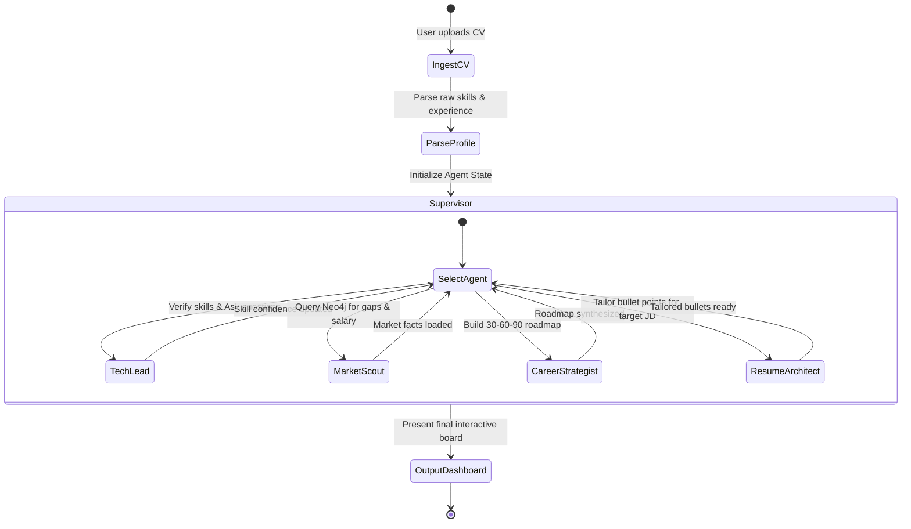

# Product Requirements Document (PRD): SkillNexus
*Hệ thống Đa Tác tử Cố vấn Nghề nghiệp IT & Bản đồ Tri thức Kỹ năng (Autonomous Multi-Agent System + Neo4j Graph)*

---

## 1. Executive Summary & Vision

**SkillNexus** là nền tảng Cố vấn Nghề nghiệp Đa Tác tử (Autonomous Career Multi-Agent System) xây dựng trên nền tảng **Đồ thị Tri thức Neo4j** và vận hành bởi mô hình AI nội bộ **Qwen-2.5-Coder:7B**. Thay vì cung cấp báo cáo tĩnh một chiều, SkillNexus thiết lập một hội đồng 4 tác tử AI chuyên trách hoạt động theo mô hình StateGraph:
- **Market Scout Agent**: Nắm giữ công cụ (Tool) truy vấn trực tiếp đồ thị Neo4j để lấy dữ liệu thực chứng về mức lương, nhu cầu tuyển dụng và kỹ năng đi kèm.
- **Tech Lead Interviewer Agent**: Tương tác đàm thoại 2 chiều, phản biện và thử thách năng lực kỹ thuật của ứng viên để kiểm chứng độ xác thực trước khi đưa ra chẩn đoán.
- **Career Strategist Agent**: Tổng hợp mục tiêu cá nhân và dữ liệu thị trường để thiết kế lộ trình chuyển dịch nghề nghiệp 30–60–90 ngày.
- **Resume Architect Agent**: Tinh chỉnh đạn CV (Bullet points) chuẩn ATS theo cấu trúc hành động đo lường được (Action-Context-Result).

Hệ thống chạy **100% Local AI qua Ollama**, mang lại sự riêng tư tuyệt đối cho người dùng và tuân thủ Luật Bảo vệ Dữ liệu Cá nhân (PDPL 2026).

---

## 2. Agentic User Journeys (Hành trình Trải nghiệm Tác tử)

### UJ-1: Tuấn — "Vượt qua bài test của Tech Lead Agent để vào Outsource lớn"
1. **Khởi tạo**: Tuấn tải file PDF CV lên SkillNexus. Hệ thống bóc tách được các kỹ năng: `Java Core`, `Spring Boot`, `MySQL`.
2. **Kích hoạt Tech Lead Agent (Verification Loop)**:
   - Thay vì khen ngợi suông, Tech Lead Agent chào Tuấn và đưa ra câu hỏi thử thách:
     > *"Chào Tuấn, anh thấy trong CV em ghi có kinh nghiệm Spring Boot và MySQL. Em hãy giải thích ngắn gọn: Trong Spring Data JPA, hiện tượng N+1 Query là gì và em dùng cách nào để tối ưu?"*
   - Tuấn trả lời qua ô chat. Tech Lead Agent chấm điểm mức độ hiểu biết thực tế: *Đạt 7/10 (Nắm được khái niệm, cần bổ sung cú pháp @EntityGraph)*.
3. **Kích hoạt Market Scout Agent (Tool Execution)**:
   - Market Scout Agent tự động gọi tool Cypher truy vấn 100 tin tuyển dụng Java Fresher mới nhất tại Hà Nội.
   - Báo cáo phản hồi: 85% công ty outsource đang đòi hỏi thêm `Docker Compose` và `Git Flow` cho các bài test đầu vào.
4. **Kích hoạt Career Strategist & Resume Architect**:
   - Career Strategist đưa ra lộ trình 30 ngày tập trung giải quyết bài toán Docker hóa ứng dụng Spring Boot.
   - Resume Architect viết lại 3 gạch đầu dòng kinh nghiệm đồ án tốt nghiệp của Tuấn từ dạng "Làm bài tập" thành dạng "Thiết kế RESTful Service có containerization".

---

## 3. Product Architecture: LangGraph Multi-Agent Workflow

---

## 4. Functional Requirements (FRs)

### Cluster 1: Multi-Agent Orchestration & State Management (FR-1xx)
* **FR-101**: Hệ thống PHẢI sử dụng **LangGraph StateGraph** để quản lý trạng thái hội thoại và dữ liệu ứng viên xuyên suốt các Agent.
* **FR-102**: Hệ thống PHẢI có một **Supervisor / Router Node** chịu trách nhiệm phân tích ý định (Intent) của người dùng và điều phối lời thoại sang Agent tương ứng.
* **FR-103**: Mỗi Agent PHẢI có Persona và System Prompt rõ ràng, được tối ưu hóa riêng cho model `qwen2.5-coder:7b`.

### Cluster 2: The Market Scout Agent & Graph Tool Calling (FR-2xx)
* **FR-201**: Market Scout Agent PHẢI sở hữu Tool `query_skill_gaps(target_role, user_skills)` để thực thi Cypher Query trên Neo4j.
* **FR-202**: Market Scout Agent PHẢI sở hữu Tool `get_salary_benchmarks(skills_list, location)` để tính toán dải lương thị trường (Percentiles 25th, Median, 75th).
* **FR-203**: Market Scout Agent PHẢI tự động trích xuất các bằng chứng từ cơ sở dữ liệu để cung cấp cho Career Strategist mà không tự bịa đặt số liệu.

### Cluster 3: The Tech Lead Interviewer Agent (FR-3xx)
* **FR-301**: Tech Lead Agent PHẢI tự động sinh từ 2 đến 3 câu hỏi phỏng vấn kỹ thuật bám sát các kỹ năng trọng tâm được liệt kê trong CV.
* **FR-302**: Tech Lead Agent PHẢI đánh giá câu trả lời của ứng viên theo thang điểm 1–10 và phân loại độ thuần thục: `Beginner`, `Intermediate`, `Advanced`.
* **FR-303**: Điểm xác thực của Tech Lead Agent PHẢI được cập nhật ngược lại vào thuộc tính quan hệ `(:User)-[:POSSESSES {verified_score}]->(:Skill)` trên Neo4j.

### Cluster 4: The Career Strategist Agent (FR-4xx)
* **FR-401**: Career Strategist Agent PHẢI tổng hợp dữ liệu từ Tech Lead và Market Scout để tạo lộ trình cá nhân hóa 30–60–90 ngày.
* **FR-402**: Lộ trình PHẢI bao gồm đề bài một dự án Capstone Project thực chiến có thể deploy lên cloud.
* **FR-403**: Người dùng PHẢI có khả năng chat trực tiếp để yêu cầu Career Strategist điều chỉnh lộ trình (ví dụ: *"Tôi chỉ có 1 tiếng mỗi tối để học"*).

### Cluster 5: The Resume Architect Agent (FR-5xx)
* **FR-501**: Resume Architect Agent PHẢI so sánh CV người dùng với 1 JD mục tiêu và chỉ ra các từ khóa kỹ thuật bị thiếu.
* **FR-502**: Resume Architect Agent PHẢI gợi ý viết lại các gạch đầu dòng kinh nghiệm theo cấu trúc chuẩn quốc tế: Action Verb + Context + Measurable Result (Google XYZ Formula).
* **FR-503**: Resume Architect Agent PHẢI cảnh báo nếu phát hiện thông tin ứng viên có dấu hiệu "chém gió" quá xa so với đánh giá của Tech Lead Agent.

---

## 5. Non-Functional Requirements (NFRs)

* **NFR-101 (Local Inference Speed)**: Thời gian phản hồi cho mỗi lượt hội thoại của Agent với Ollama `qwen2.5-coder:7b` PHẢI $\le 5$ giây (áp dụng streaming token hiển thị tức thì).
* **NFR-102 (Tool Calling Accuracy)**: Tỷ lệ gọi đúng Tool và sinh đúng tham số JSON của `qwen2.5-coder:7b` PHẢI đạt $\ge 90\%$.
* **NFR-103 (Privacy & PDPL 2026)**: Toàn bộ quá trình suy luận của Agent diễn ra tại máy chủ cục bộ (Localhost); hỗ trợ tùy chọn Anonymous Mode loại bỏ 100% PII.
