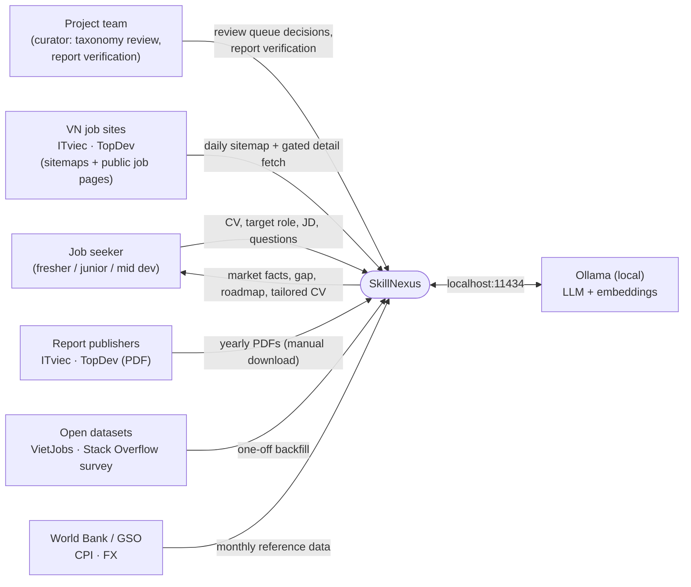
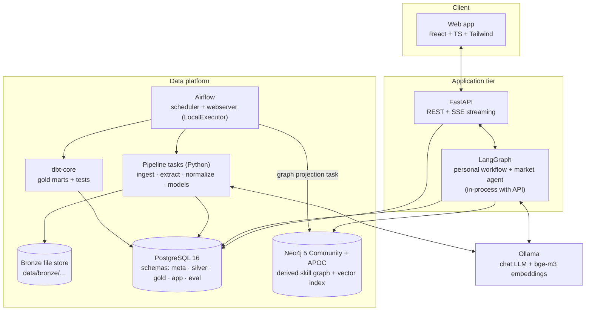
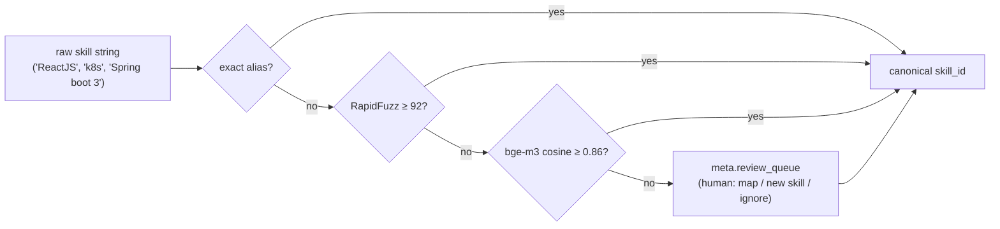
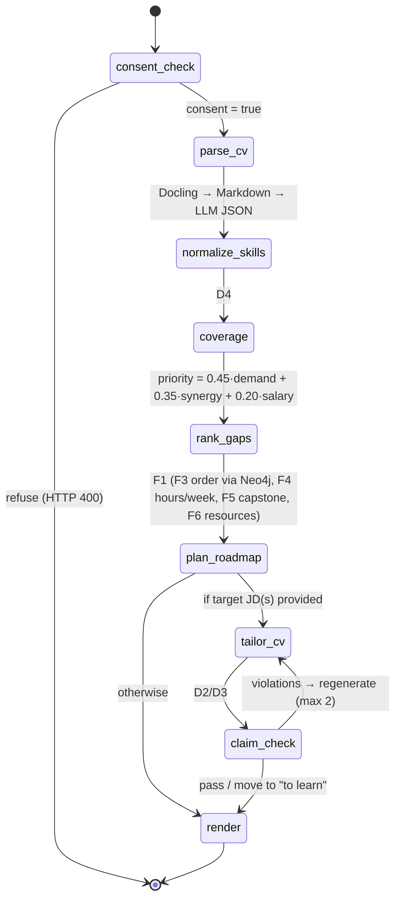

# SkillNexus — Architecture Overview (MVP)

> **One-line summary:** a batch data platform (Airflow → Postgres medallion → dbt marts → Neo4j projection) produces **provenance-tagged market facts**. A local-LLM application layer (FastAPI + LangGraph + Ollama) turns those facts into four user-facing modules: **Market Pulse → Trends & Salary → My Gap & Plan → My CV**.

Feature IDs (A2, B5, D8, …) refer to the [feature catalog](../brainstorming/brainstorm-skillnexus-target-and-solution-2026-10-21/feature-catalog.md).

---

## 1. Scope

| Module | Core features in MVP | Primary owner |
|---|---|---|
| **M1 Market Pulse** | A2 skill demand by role × level × city · A3 skill bundles · A4 JD inflation index · A8 ask-the-market agent · (A5, F9 byproducts) | M1 DE + M2 DS |
| **M2 Trends & Salary** | B5 report digitization → B2 momentum · C1 worth range · C2 skill premium · C7 real wages | M2 DS |
| **M3 My Gap & Plan** | D4 market-coverage score · F1 gap roadmap (F3 ordering, F4 time budget, F5 capstone, F6 resources) | M3 AI-APP |
| **M4 My CV** | D2 + D3 JD-tailored CV · D8 claim-vs-evidence check · (D5 batch) | M3 AI-APP |

**Out of scope for the MVP:** forecasting (B7, B8), ghost-job detection (E3), company intelligence (H1, H3), auto-apply (dropped), mock interview agent (G1), payments.

---

## 2. Architectural drivers

### 2.1 Quality attributes (ranked)

| # | Attribute | What it means here | How the architecture answers |
|---|---|---|---|
| Q1 | **Honesty / provenance** | No number without its source, period and sample size; no fake trends | Provenance contract on every gold row (§5.4); "math computes, LLM narrates" (ADR-04) |
| Q2 | **Privacy (PDPL, Law 91/2025/QH15, effective 2026-01-01)** | CVs are personal data | Local inference only for user data; consent gate; retention limits; user data isolated from market data (§10) |
| Q3 | **Reproducibility** | Any mart can be rebuilt from raw inputs | Immutable bronze + manifests; idempotent tasks; dbt lineage |
| Q4 | **Buildable by 3 people in 8 weeks** | Few moving parts, no exotic infrastructure | Drop MinIO, Redis, Kafka/CDC; one orchestrator; one agent |
| Q5 | **Runs on one laptop (16–32 GB RAM)** | Demo without cloud spend | Resource budget (§11.2); heavy jobs scheduled apart |
| Q6 | **Testable AI** | Prove quality at the defense | Gold sets + eval DAG with tracked metrics (§8.6) |

### 2.2 Constraints and facts that shape the design (verified 2026-10-22)

- **VietJobs** (`dinhieufam/VietJobs`, LREC 2026) is a **one-week crawl of TopCV in July 2025**, 48,092 postings across 16 sectors. Only **1,906** rows are in the IT category, and only **≈794** rows across all categories are real software/data postings (≥ 2 developer skills). **342** of those have a salary. It's a useful seed and baseline, **not** a primary source.
- **The `robots.txt` files** of ITviec, TopDev, TopCV and VietnamWorks **allow job pages**; only login, apply, CV and private paths are disallowed.
- **ITviec and TopDev publish job sitemaps** regenerated daily: ~640 live IT job URLs on ITviec (EN) and ~2,780 on TopDev (mixed sectors).
- **TopDev's terms** forbid copying or redistributing content and commercial exploitation. ITviec's terms were not located. → Facts-only extraction for non-commercial academic use, gated by a team sign-off (ADR-08).
- **The annual reports give only yearly points:** ITviec salary reports 2022-23 → 2025-26 (4 editions, n = 1,257 – 2,324) and TopDev reports 2021 → 2024-25.
- **The MinIO community edition** stopped shipping images/binaries in Oct 2025 and has since been archived.

---

## 3. System context (C4 level 1)



---

## 4. Containers (C4 level 2)



| Container | Responsibility | Tech | Owner |
|---|---|---|---|
| Web app | 4 module views + Ask tab + data-freshness badge | React, TypeScript, Tailwind (existing scaffold) | M3 |
| API | Endpoints (§9.1), auth-less demo sessions, consent, deletion | FastAPI (existing) | M3 |
| LangGraph | Personal workflow (§8.3) + ask-the-market agent (§8.4) | LangGraph, Pydantic | M3 |
| Airflow | Scheduling, retries, backfills, human-verification gates | Apache Airflow (LocalExecutor) | M1 |
| Pipeline tasks | Ingest, LLM extraction, normalization, DS models | Python, pandas/polars, statsmodels, scikit-learn | M1 + M2 |
| dbt | Gold marts, data tests, lineage docs | dbt-core + dbt-postgres | M1 |
| Bronze store | Immutable raw files + manifests | Local filesystem (Parquet / JSON / PDF / XML) | M1 |
| PostgreSQL | System of record: silver, gold, app, eval, metadata | Postgres 16 | M1 |
| Neo4j | Derived graph for bundles, paths, roadmap ordering; vector index | Neo4j 5 Community + APOC | M2 |
| Ollama | Local LLM inference + embeddings | Ollama; model chosen by benchmark (§8.1) | M3 |

---

## 5. Data architecture

### 5.1 Sources and ingestion

| ID | Source | Method | Schedule | Volume (est.) | Gate |
|---|---|---|---|---|---|
| S0 | **ITviec + TopDev job sitemaps** | HTTP GET of sitemap XML; diff vs yesterday | Daily 06:00 | ~640 + ~2,780 URLs/day, ~2 MB | None (sitemaps exist for crawlers) |
| S1 | **Job detail pages** (new URLs only) | Rate-limited fetch (≥ 5 s between requests, honest UA), LLM fact extraction, raw HTML kept ≤ 30 days in bronze | Daily 07:00 | ~50–150 new pages/day | **G1: team ToS sign-off** (feature flag `DETAIL_CRAWL_ENABLED`) |
| S2 | VietJobs (HF Parquet) | One-off download; filter dev postings | Once | 48,092 rows → ~794 dev | License check |
| S3 | ITviec salary reports (4 editions) | Manual PDF download → table extraction → **human verification** | Once + yearly | ~4 PDFs, ~30–60 tables | Citation required |
| S4 | TopDev market reports | Same as S3 | Once + yearly | ~4 PDFs | Citation required |
| S5 | Stack Overflow Developer Survey | CSV download | Once + yearly | ~50k rows/year (VN subset small) | ODbL attribution |
| S6 | **User-pasted JDs** | From the tailoring flow, with opt-in `contribute=true` | Hourly micro-batch | grows with usage | User consent |
| S7 | CPI + FX | World Bank API / GSO | Monthly | tiny | None |
| S8 | Curated learning resources + skill effort hours + prerequisites | Team-authored YAML in repo | On change | ~50 skills | None |
| S9 *(optional)* | jobspipe.dev API (12-month history, MNC-heavy) | REST | Once / weekly | ≤ 1,000 free credits | Human sign-up; verify VN volume |

### 5.2 Medallion layout

```
data/bronze/                               # immutable, never edited
  source=itviec_sitemap/date=2026-10-26/sitemap.xml
  source=topdev_sitemap/date=2026-10-26/sitemap-*.xml
  source=itviec_detail/date=2026-10-26/<job_hash>.html      # purged after 30 days
  source=vietjobs/version=hf-2025-07/vietjobs.parquet
  source=itviec_report/edition=2024-2025/report.pdf
  source=so_survey/year=2025/survey_results_public.csv
  source=cpi_fx/date=2026-11-01/*.json
  _manifest/                                 # one JSON per file: url, sha256, license, retrieved_at, retriever
```

Postgres schemas:

| Schema | Contents |
|---|---|
| `meta` | `source_file` (manifest mirror), `pipeline_run`, `review_queue` |
| `silver` | Cleaned, typed, normalized entities (one row per real-world thing) |
| `gold` | dbt marts: aggregates with the provenance contract |
| `app` | Users/sessions, CVs, parsed profiles, roadmaps, tailoring results, contributed JDs |
| `eval` | Gold labels, evaluation runs and metrics |

### 5.3 Core data model

**Dimensions** (conformed, shared by every source):
`dim_skill (skill_id, canonical_name, category, effort_hours, is_active)` ·
`dim_skill_alias (alias, skill_id, method[dict|fuzzy|embedding|manual], confidence)` ·
`dim_role (role_id, name)` — Backend, Frontend, Fullstack, Mobile, Data Engineer, Data Analyst/Scientist, AI/ML Engineer, DevOps/SRE, QA/Tester, Embedded, BA, Other ·
`dim_level` — Intern/Fresher, Junior, Mid, Senior, Lead+ ·
`dim_city` — Hà Nội, TP.HCM, Đà Nẵng, Other, Remote ·
`dim_source (source_id, kind[job_posting|salary_survey|dev_survey|reference], publisher, license, citation)`

**Silver facts:**

| Table | Grain | Key columns |
|---|---|---|
| `silver.job_sighting` | job URL × snapshot date | `job_key`, `source`, `url`, `slug_title`, `snapshot_date` → enables `first_seen` / `last_seen` |
| `silver.job_posting` | one posting | `job_key`, `source`, `first_seen`, `last_seen`, `title_raw`, `role_id`, `level_id`, `city_id`, `min_exp_months`, `salary_min_vnd`, `salary_max_vnd`, `salary_hidden`, `lang`, `extraction_model`, `extraction_confidence` |
| `silver.job_posting_skill` | posting × skill | `job_key`, `skill_id`, `is_mandatory`, `raw_text` |
| `silver.report_fact` | one verified table cell | `source_id`, `edition`, `page`, `table_ref`, `role_id`, `exp_band`, `skill_id`, `metric`, `value`, `unit`, `n`, `verified_by`, `verified_at` |
| `silver.survey_response` | SO respondent (filtered) | `year`, `country`, `dev_type`, `years_code`, `comp_usd`, `skills[]` |
| `silver.cpi_fx` | month | `cpi_index`, `usd_vnd` |

### 5.4 The provenance contract: `gold.fct_market_observation`

Every number the product shows comes from this table (or a mart built on it). Sources with different time granularity can't produce fake trend lines, because each row records **what kind of observation it is**.

```sql
CREATE TABLE gold.fct_market_observation (
  obs_id        BIGSERIAL PRIMARY KEY,
  source_id     TEXT  NOT NULL,          -- 'itviec_detail' | 'vietjobs' | 'itviec_report_2024_25' | 'so_2025' | 'user_jd' …
  source_kind   TEXT  NOT NULL,          -- 'job_posting' | 'salary_survey' | 'dev_survey'
  granularity   TEXT  NOT NULL,          -- 'snapshot' | 'day' | 'week' | 'year'
  period_start  DATE  NOT NULL,
  period_end    DATE  NOT NULL,
  geo           TEXT  NOT NULL,          -- 'VN' | 'VN-HN' | 'VN-HCM' | 'VN-DN' | 'GLOBAL'
  role_id       INT, level_id INT, skill_id INT,   -- NULL = all
  metric        TEXT  NOT NULL,          -- 'demand_share' | 'posting_count' | 'salary_p25' | 'salary_median' | 'salary_p75' | 'usage_share' | 'salary_hidden_share' …
  value         NUMERIC NOT NULL,
  unit          TEXT  NOT NULL,          -- 'share' | 'count' | 'VND_month' | 'USD_year'
  n             INT   NOT NULL,          -- sample size behind value
  method        TEXT  NOT NULL,          -- dbt model or analysis id + version
  confidence    TEXT  NOT NULL           -- 'high' (n≥100) | 'medium' (30≤n<100) | 'low' (n<30, hidden in UI)
);
```

**Rules**
1. A trend line (B2) only connects points with the **same `source_id` family and `metric`**.
2. Cross-source comparisons are shown side by side and labelled.
3. The UI hides `confidence = 'low'` values unless the user expands "show low-confidence".
4. Every API response that carries a number also carries `{source, period, n, confidence}`.

**Gold marts** (dbt models, all derived from silver + `fct_market_observation`):
`mart_skill_demand` (A2, F9) · `mart_skill_cooccurrence` (A3) · `mart_jd_inflation` (A4) · `mart_salary_bands` (C1, A5) · `mart_skill_premium` (C2) · `mart_momentum` (B2) · `mart_real_wages` (C7) · `mart_freshness` (per-source last success, row counts).

### 5.5 Skill taxonomy and entity resolution



- **Seed:** VietJobs dev subset (≈1,383 distinct skill strings) + the existing 28-skill Postgres seed + the alias dict in [normalizer.py](../../backend/app/services/normalizer.py).
- **Target:** ≥ 90% of skill mentions resolved automatically; review queue cleared weekly.
- **B3 (emerging skills, stretch)** reads directly from `review_queue`: an unresolved string that appears in ≥ N new postings within 14 days becomes a "new in market" candidate.

### 5.6 Neo4j projection (derived, rebuilt nightly)

```
(:Skill {skill_id, name, category, effort_hours, demand_share})
(:Role  {role_id, name})
(:Skill)-[:CO_OCCURS {lift, pmi, n}]-(:Skill)                 // A3, from mart_skill_cooccurrence (lift > 1.2, n ≥ 20)
(:Role)-[:DEMANDS {level, share, n, premium_pct}]->(:Skill)    // A2/C2 per role & level
(:Skill)-[:PREREQUISITE_OF {curated:true}]->(:Skill)           // S8, team-authored
```

- **Rebuild:** `MATCH (n) DETACH DELETE n`, then a batched `UNWIND … MERGE` from gold views. The graph holds market data only; **no user nodes** (ADR-09).
- **F3 ordering:** `apoc.algo.dijkstra` over `PREREQUISITE_OF`, weighted by `effort_hours`, restricted to the user's missing skills. A topological sort gives the learning order.
- **Vector index:** `skill_embeddings` on `Skill.embedding` with **1024 dims** (bge-m3), used for alias matching and resource retrieval.

### 5.7 Data quality

| Check | Where | Threshold |
|---|---|---|
| Not-null / accepted values / unique keys | dbt tests on silver + gold | 100% pass, otherwise the DAG fails |
| Sample-size floor | dbt test on `fct_market_observation` | `confidence` correctly derived from `n` |
| Freshness | dbt source freshness on `job_sighting` | warn > 36 h, error > 72 h |
| Extraction drift | eval DAG on the 50-JD gold set | skill F1 ≥ 0.85; alert on a drop > 5 pts |
| Normalizer coverage | `mart_freshness` | ≥ 90% of mentions auto-resolved |

---

## 6. Pipelines (Airflow DAGs)

| DAG | Schedule | Tasks | Owner |
|---|---|---|---|
| `dag_sitemap_snapshot` | daily 06:00 | fetch ITviec + TopDev sitemaps → bronze → parse URLs → upsert `silver.job_sighting` | M1 |
| `dag_job_detail_extract` | daily 07:00 (flag-gated) | select new `job_key`s → polite fetch → LLM JSON extraction → Pydantic validation → `silver.job_posting(_skill)` → purge raw > 30 days | M1 + M2 |
| `dag_backfill_vietjobs` | manual, once | download Parquet → filter dev postings → parse `technical_skills` (literal list) → map `experience_required` → months/level → salary (0 = hidden) → silver; `period = 2025-07` | M1 |
| `dag_backfill_reports` | manual | PDF → Docling tables → LLM structuring → `meta.review_queue` → **ExternalTaskSensor waits for "verified"** → `silver.report_fact` | M2 |
| `dag_backfill_so_survey` | manual / yearly | CSV → filter → `silver.survey_response` | M1 |
| `dag_reference_cpi_fx` | monthly | World Bank / GSO → `silver.cpi_fx` | M1 |
| `dag_user_jd_ingest` | hourly | `app.contributed_jd` (opt-in) → same extractor as detail pages → silver (`source = user_jd`) | M1 |
| `dag_normalize` | after each ingest | alias → fuzzy → embedding → review queue | M2 |
| `dag_transform_gold` | daily 08:00 | `dbt build` (models + tests) | M1 |
| `dag_analytics_models` | weekly | co-occurrence lift/PMI, JD-inflation definition, salary regression, momentum, CPI deflation → gold tables with `method` version | M2 |
| `dag_graph_projection` | daily after gold | rebuild Neo4j from gold views, refresh embeddings | M2 |
| `dag_eval` | weekly + on model/prompt change | extraction, CV parsing, agent Q&A, claim-check evals → `eval.run` | M2 + M3 |

**Idempotency:**
- Every task writes by `(source, date)` partition and uses upserts keyed on natural keys (`job_key = sha256(source + canonical_url)`).
- Re-running any day reproduces the same silver rows.

---

## 7. Analytics and models (DS layer)

| Feature | Method | Output | Honesty rule |
|---|---|---|---|
| **A2** demand | `share = postings with skill / postings in segment` per role × level × city × period | `mart_skill_demand` | Hide n < 30 |
| **A3** bundles | Pairwise counts → lift and PMI | `mart_skill_cooccurrence` | lift > 1.2 and n ≥ 20 |
| **A4** JD inflation | **Data-driven "senior stack"**: the top-k skills by lift in Senior vs Fresher/Junior postings. Index = share of Fresher/Junior postings requiring ≥ 24 months **or** ≥ 2 senior-stack skills | `mart_jd_inflation` per role and period | Definition versioned in `method` |
| **C1 / C2** salary | `log(mid_salary) ~ skills(top-k dummies) + level + city + role` (OLS + quantile regression on postings with a visible salary). Premium = `exp(β) − 1` with 95% CI. C1 = prediction interval for the user's profile | `mart_skill_premium`, `mart_salary_bands` | Report only significant premiums with n ≥ 30; postings (advertised) and surveys (actual) shown side by side, never pooled |
| **B2** momentum | Within one source series: log-linear slope over ≥ 3 yearly points (reports), or week-over-week counts (sitemaps, once ≥ 6 weeks exist) | `mart_momentum` with `Rising / Flat / Falling` + confidence | **No numeric forecast** in the MVP |
| **C7** real wages | Nominal median ÷ CPI (base 2022) | `mart_real_wages` | Show nominal and real together |
| *C3 (stretch)* | Gradient boosting imputation for hidden salaries; report RMSE / R² against the VietJobs paper's published LLM baselines (best R² = 0.16) using a comparable protocol | `gold.salary_imputation` | Imputed values flagged everywhere |

Deliverables of this layer include **EDA notebooks** (`notebooks/`) that explain each definition. They double as defense material.

---

## 8. AI architecture

### 8.1 Model runtime and selection

- **Runtime:** Ollama on `localhost:11434` for **all user data** (CV, profile).
- **Chat-model candidates:** benchmarked in week 2 on the 50-JD extraction gold set and 10 CVs.
  - `qwen2.5:7b-instruct`: VietJobs paper baseline
  - `qwen3:8b`
  - SEA-LION v3 8B: best VietJobs salary baseline
  - `qwen2.5-coder:7b`: current choice in the repo
- **Selection metrics:** skill-extraction F1, JSON validity rate, tokens/s, Vietnamese prose quality (rubric).
- **Embeddings:** `bge-m3` (multilingual, 1024-d), replacing `nomic-embed-text`.
- **Public-data option:** for public data only (job pages, reports), a cloud batch LLM may be switched on if local throughput blocks the timeline. It's off by default, and CVs never go to the cloud (ADR-06).

### 8.2 LLM-in-ETL extraction

```
job page / user JD
  → strip HTML (readability)
  → prompt with JSON schema (title, role, level, min_exp_months, salary_min/max, salary_hidden, city, skills[{name, mandatory}])
  → Ollama format=json, temperature 0.1
  → Pydantic validation → 1 retry with error message on failure
  → normalize skills (§5.5)
  → silver (with extraction_model + confidence)
```

- **Throughput budget:** ~100 postings/day × ~6 s ≈ 10 min/day. The one-off live-set backfill (~2–3k postings) ≈ 4–5 h, run overnight.
- **Rules before LLM:** VietJobs `technical_skills` is already a list, so it needs no LLM. Salary text patterns are parsed with regex first.

### 8.3 Personal workflow (deterministic LangGraph)



**State (Pydantic):**
```python
class PersonalState(BaseModel):
    resume_id: UUID
    target: Target                       # role_id, level_id, city_id, hours_per_week
    cv_markdown: str                      # deleted from state after parse
    cv_skills: list[ProfileSkill]         # skill_id, evidence_spans[], years
    coverage: CoverageResult              # score, matched[], missing[{skill_id, demand_share, n}], provenance
    gaps_ranked: list[GapItem]            # priority components kept for explanation
    roadmap: Roadmap | None               # weeks[], milestones[], capstone, resources[]
    target_jds: list[ExtractedJD] = []
    tailored: list[TailoredBullet] = []   # original, rewritten, keywords, evidence_ref
    claim_report: ClaimReport | None      # violations[], moved_to_learn[]
```

- **D4 coverage:** `Σ demand_share(matched) / Σ demand_share(top-N skills of segment)`. It's displayed as "covers X% of skill demand across N postings", **never as a hiring probability**.
- **D8 claim check:** every skill, tool, number or employer mentioned in a rewritten bullet must match an `evidence_span` in the parsed CV (exact/alias match, plus an LLM entailment check for metrics). Unmatched items are removed or moved to the "to learn" list.

### 8.4 Ask-the-market agent (A8)

- **Pattern:** a single ReAct agent in LangGraph with three tools:

| Tool | Does | Guardrails |
|---|---|---|
| `query_market(view, filters, group_by, limit)` | Parameterized SELECT over **whitelisted gold views only** | Read-only DB role `agent_ro`; no raw SQL from the LLM; `limit ≤ 200`; 5 s timeout |
| `query_graph(template_id, params)` | One of ~8 vetted Cypher templates (bundles, paths, neighbours) | Read-only Neo4j user; templates only |
| `make_chart(spec)` | Returns a Vega-Lite spec rendered by the UI | Data only from previous tool outputs |

- **Answer contract:**
  - Every number in the answer must come from a tool result in the same turn and is cited as `[source · period · n]`.
  - If the needed data has `confidence = 'low'`, the agent says so instead of answering.
  - The agent stops after a maximum of 6 tool calls.
- **Why templates, not free text-to-SQL:** a 7B model writing raw SQL is the main source of wrong numbers. Typed tool arguments are testable and safe.
- **Differentiation from prior work (arXiv 2511.14767):** provenance-enforced answers and time-aware data.

### 8.5 Guardrail summary

| Risk | Guardrail |
|---|---|
| Invented market numbers | Math computes / LLM narrates; citation contract; tool-only numbers |
| Invented CV experience | D8 claim check + diff view + "to learn" bucket |
| Prompt injection via JD or CV text | JD/CV text is passed as data in delimited blocks; tools cannot be called from the extraction prompts; the agent can't reach `app` schema |
| Overclaiming trends | Provenance rules (§5.4); no forecasts in MVP |
| PII leakage | Local inference; PII fields dropped after parse in anonymous mode; no PII in logs |

### 8.6 Evaluation harness

| Gold set | Size | Built by | Metrics | MVP target |
|---|---|---|---|---|
| JD extraction | 50 postings (25 ITviec/TopDev, 25 VietJobs) | M2 (+ all label) | Skill P/R/F1; level, salary, city accuracy; JSON validity | F1 ≥ 0.85; field acc ≥ 0.90; validity ≥ 0.98 |
| CV parsing | 10 CVs (team + consenting volunteers, anonymized) | M3 | Skill P/R/F1; years accuracy | F1 ≥ 0.85 |
| Tailoring claim check | 10 CVs × 2 JDs | M3 | Fabricated claims in final output | **0** |
| Market Q&A | 30 questions with SQL-computed answers | M2 + M3 | Exact/within-tolerance accuracy; citation presence | ≥ 80% accurate; 100% cited |
| Normalizer | All silver mentions | M2 | Auto-resolution rate | ≥ 90% |

Results are written to `eval.run` and charted on an internal page and in the defense slides.

---

## 9. Application layer

### 9.1 API (FastAPI, `/api/v1`)

| Method & path | Purpose | Feature |
|---|---|---|
| `GET /market/overview?role&level&city` | Top skills, posting counts, salary-hidden share, freshness | A2, A5 |
| `GET /market/skills/{skill}` | Demand, co-occurring skills, premium, momentum | A2, A3, C2, B2 |
| `GET /market/inflation?role` | JD inflation index + senior-stack definition | A4 |
| `GET /market/salary?role&level&city` | Bands from postings and surveys (side by side), real vs nominal | C1, C7 |
| `GET /market/trends?metric&role` | Momentum series with provenance | B2 |
| `POST /market/ask` (SSE) | Ask-the-market agent | A8 |
| `POST /cv/upload` | Consent-gated upload → `resume_id` (replaces the hardcoded stub at [main.py:68](../../backend/app/main.py#L68)) | — |
| `GET /cv/{id}/coverage?role&level&city` | Coverage score + missing skills | D4 |
| `POST /roadmap` | `{resume_id, target, hours_per_week}` → roadmap | F1 |
| `POST /tailor` | `{resume_id, jd_text \| jd_ids[], contribute}` → bullets + claim report | D2, D3, D8, D5 |
| `DELETE /me/data` | Hard delete of all user rows + files | PDPL |
| `GET /meta/freshness` | Last successful run + row counts per source | Q1 |

Every market response includes `provenance: {source, period, n, confidence}`.

### 9.2 Frontend views

| View | Existing component to evolve | Shows |
|---|---|---|
| Market Pulse | `MetricsOverview`, `SkillGraphExplorer` | A2 leaderboard, A3 graph, A4 inflation, A5 transparency |
| Trends & Salary | *new* | B2 momentum, C1/C2 salary, C7 real wages |
| My Gap & Plan | `RoadmapAndTailor` (roadmap half), `IngestionModal` | D4 coverage, F1 roadmap |
| My CV | `RoadmapAndTailor` (tailor half) | D2/D3 diff view, D8 claim report |
| Ask | `AdvisoryBoard` → single agent chat | A8 with citations |

A **freshness badge** is shown on every view, e.g. "ITviec · updated 06:12 today · 1,240 postings".

---

## 10. Security and privacy (PDPL, Law 91/2025/QH15)

| Concern | Control |
|---|---|
| Consent | Explicit, unbundled consent checkbox per upload (already enforced in the API); separate opt-in for contributing JDs |
| Data minimization | Store parsed skills + evidence spans, not the full CV text; anonymous mode drops name/email/phone |
| Local processing | CV text is only sent to `localhost` Ollama; no cloud LLM for user data |
| Retention | Raw CV file deleted ≤ 24 h after parse; parsed profile kept until `DELETE /me/data` or 90 days of inactivity |
| Isolation | User data lives only in `app` schema; it **never** enters `silver`/`gold`/Neo4j (ADR-09). Contributed JDs are de-linked from the user before ingestion |
| Least privilege | Agent uses `agent_ro` (SELECT on whitelisted gold views); pipelines use `etl_rw`; app uses `app_rw` |
| Third-party content | Facts-only storage; raw HTML purged after 30 days; citations on report-derived numbers; non-commercial academic use |
| Secrets | `.env` (not committed), `.env.example` documented |

---

## 11. Deployment and operations

### 11.1 docker-compose services (target)

| Service | Image | Notes |
|---|---|---|
| `postgres` | `postgres:16-alpine` | Keep; add schemas + roles via init SQL |
| `neo4j` | `neo4j:5.26-community` + APOC | Keep; heap 1 GB for dev |
| `airflow` | `apache/airflow` (standalone / LocalExecutor) | **Add**; metadata DB in the same Postgres (separate database) |
| `api` | Python 3.11 slim | FastAPI + LangGraph |
| `web` | Node 20 (dev) / Nginx (demo build) | React app |
| `ollama` | Host install (GPU access) or `ollama/ollama` | Models pulled once |
| ~~`minio`~~ | — | **Removed** (bronze = bind-mounted `./data`) |
| ~~`redis`~~ | — | **Removed** (no workload needs it) |

### 11.2 Resource budget (single laptop)

| Component | RAM (approx.) |
|---|---|
| Postgres | 0.5 GB |
| Neo4j (heap 1 GB + page cache 0.5 GB) | 1.5–2 GB |
| Airflow standalone | 1.5–2 GB |
| Ollama 7–8B Q4 | 5–6 GB (VRAM if GPU) |
| API + web | ~1 GB |
| **Total** | **≈ 10–12 GB** → 16 GB workable, 32 GB comfortable |

### 11.3 Operations

- **Observability:** Airflow UI for runs, `meta.pipeline_run` for history, structured JSON logs of every agent tool call (Langfuse is a stretch goal).
- **Backups:** nightly `pg_dump` of `silver`, `gold`, `eval` plus the bronze folder. Neo4j is rebuildable, so it isn't backed up.
- **Demo reset:** `make demo-reset` rebuilds gold and the graph from silver in < 15 min.

---

## 12. Repository layout (target)

```
SkillNexus/
├── docker-compose.yml
├── Makefile                     # up, demo-reset, eval, backfill-*
├── data/                        # bronze (git-ignored)
├── contracts/                   # shared Pydantic schemas (JD, CV, provenance)
├── pipeline/                    # M1 + M2
│   ├── dags/                    # Airflow DAGs (§6)
│   ├── ingest/                  # sitemap, detail, vietjobs, reports, so, cpi_fx
│   ├── extract/                 # LLM extraction prompts + validators
│   ├── normalize/               # taxonomy, aliases, review queue
│   ├── analytics/               # A3, A4, C2, B2, C7 models
│   └── graph/                   # Neo4j projection
├── dbt_skillnexus/              # M1: staging → silver → gold, tests
├── backend/                     # M3: FastAPI app, LangGraph workflow + agent
├── frontend/                    # M3: React app (existing)
├── eval/                        # gold sets + eval scripts (all)
├── notebooks/                   # EDA + definitions (M2)
└── reference/                   # skills.yaml (effort, prerequisites, resources)
```

The existing `pipeline/extractors/vietjobs_loader.py` moves to `pipeline/ingest/vietjobs.py` with corrected column mapping (`technical_skills`, `salary_min/max`, `experience_required`). There's no company column.

---

## 13. Ownership map

| Component | Member 1 — Data Engineer | Member 2 — Data Scientist & Knowledge Graph | Member 3 — Applied AI & Full-stack |
|---|---|---|---|
| Infra (compose, roles, Makefile) | **R** | C | C |
| Ingestion DAGs (S0–S7) | **R** | C (extraction prompts) | — |
| Silver / dbt gold / data tests | **R** | C (metric definitions) | I |
| Taxonomy & entity resolution | C | **R** | I |
| Report digitization + verification | C | **R** | — |
| Analytics models (A3, A4, C1/C2, B2, C7) | C | **R** | I |
| Neo4j projection + Cypher templates | C | **R** | C |
| CV parsing + personal workflow | — | C (scoring formula) | **R** |
| Ask-the-market agent | C (views, `agent_ro`) | C (Q&A gold set) | **R** |
| API + frontend | I | I | **R** |
| Evaluation harness | C | **R** (data evals) | **R** (AI evals) |

R = responsible · C = consulted · I = informed

---

## 14. Architecture decision records (summary)

| ADR | Decision | Rationale | Revisit when |
|---|---|---|---|
| 01 | **Postgres is the system of record; Neo4j is a derived projection** (nightly rebuild, no CDC) | Time-window analytics are SQL-native; graph only for paths/bundles; rebuild is simpler than sync | Graph updates must be near-real-time |
| 02 | **Bronze = local partitioned files + manifests** (MinIO removed) | MinIO community edition retired; no S3 need on one machine | Multi-machine deployment |
| 03 | **Airflow + dbt** | Industry-standard DE stack (learning value); dbt gives tests + lineage | RAM pressure → Dagster |
| 04 | **Math computes, LLM narrates**, plus the provenance contract | 7B models invent numbers; examiners need traceability | — |
| 05 | **One deterministic workflow + one tool-using agent** (replaces 4 autonomous agents) | 7B routing is fragile and hard to test; personas survive as prompt styles | Larger model available |
| 06 | **Local LLM for user data**; optional cloud batch for public data only | PDPL cross-border rules; cost | — |
| 07 | **bge-m3 embeddings (1024-d)** | Vietnamese support; spec already proposed it | — |
| 08 | **Acquisition = daily sitemap snapshots + gated detail extraction, facts only** | Sitemaps are published for crawlers; job pages allowed by robots.txt; ToS forbids copying content, so we store facts not text | Commercial launch → partnership / licensed feed |
| 09 | **User data never enters the market graph** | Trivial deletion; no PII in shared stores | — |
| 10 | **One observation table with explicit granularity; no cross-source trend lines** | Snapshot + yearly survey + daily sightings can't be joined honestly | ≥ 12 months of own dated data |

---

## 15. Phase 2 (after the MVP)

- **E3 ghost-job detector:** posting lifetime and repost patterns from `job_sighting` (needs ≥ 8–12 weeks of sightings).
- **B7 forecasting:** once ≥ 12 monthly points per skill exist from our own data.
- **More sources:** TopCV / VietnamWorks sitemaps; jobspipe or a licensed feed for commercial use.
- **I1 B2B curriculum report** and **I4 weekly newsletter** as business channels.
- **G1 interview agent** if a stronger model becomes viable locally.

## 16. Open items that need a human decision

| # | Item | Needed by | Who |
|---|---|---|---|
| H1 | **ToS sign-off for job detail extraction** (TopDev terms read; ITviec terms page not found) | End of W1 (gate G1) | Team + mentor |
| H2 | Download the ITviec / TopDev report PDFs (some behind sign-up forms) | W1 | Any member |
| H3 | jobspipe.dev sign-up to test VN volume (sandbox returns sample data only) | W2 (optional) | M1 |
| H4 | Hardware per member (RAM / GPU) → final model choice | W1 | All |
| H5 | VietJobs dataset license confirmation (paper is CC BY 4.0; dataset card unclear) | W1 | M2 |
| H6 | Volunteers for the 10-CV gold set (consent, anonymization) | W2 | M3 |
| H7 | Official project start date and grading rubric weights | Before W1 | Team lead |
